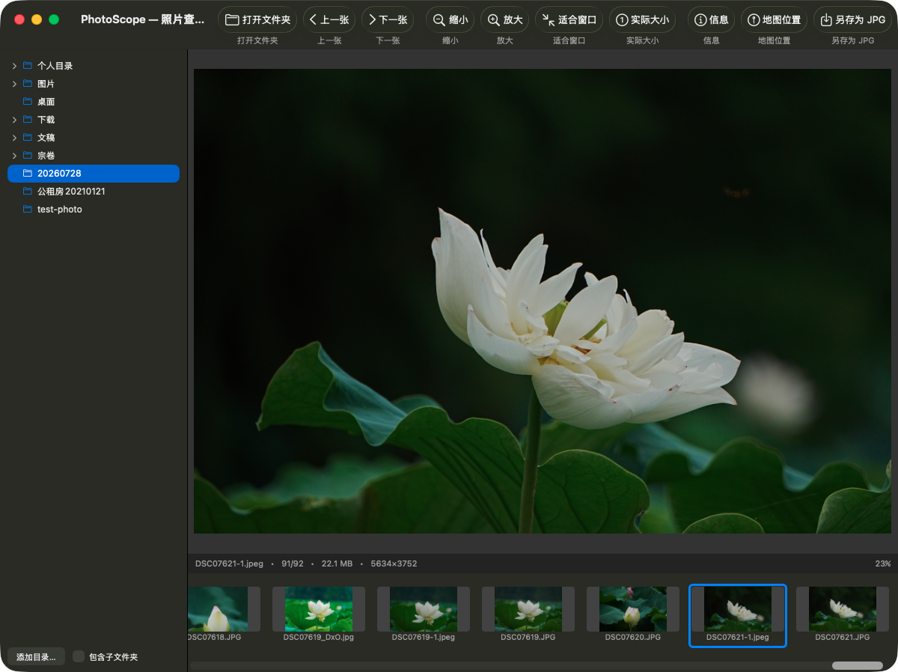
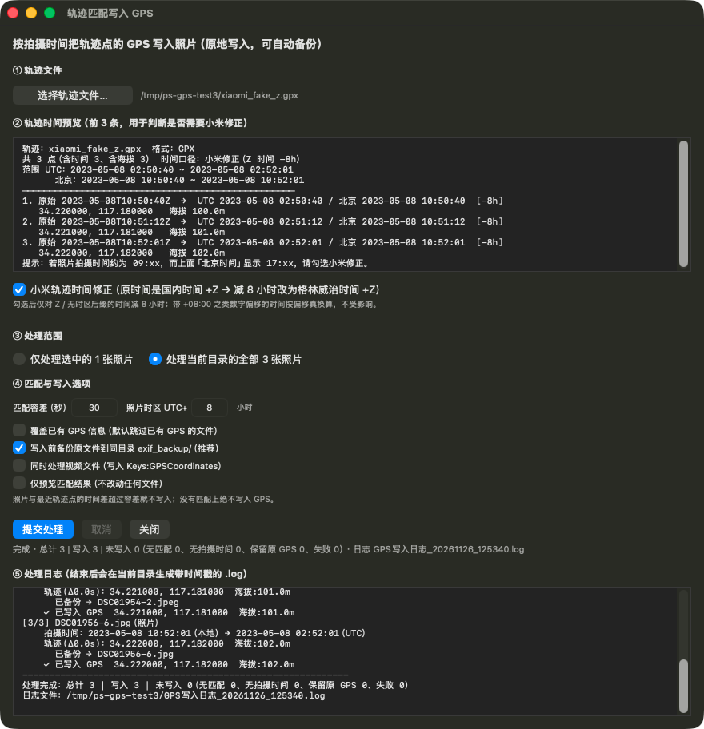
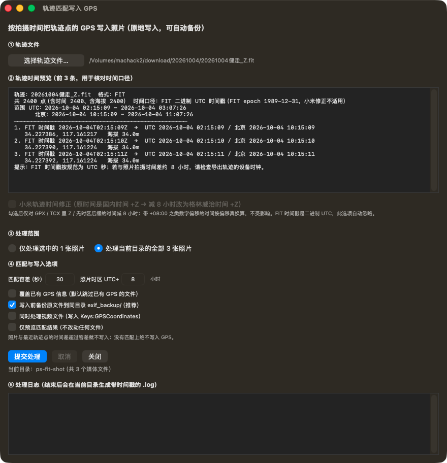
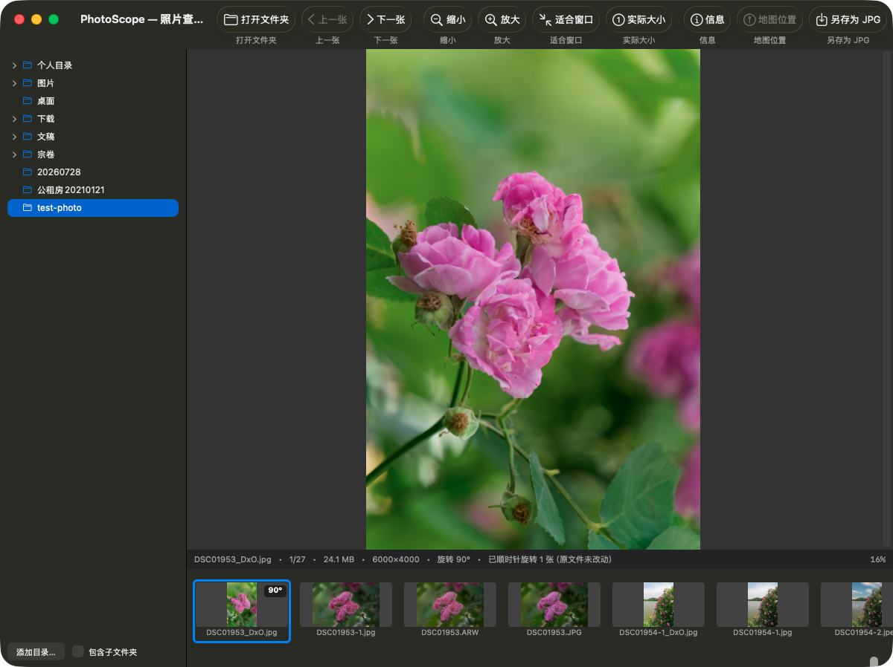
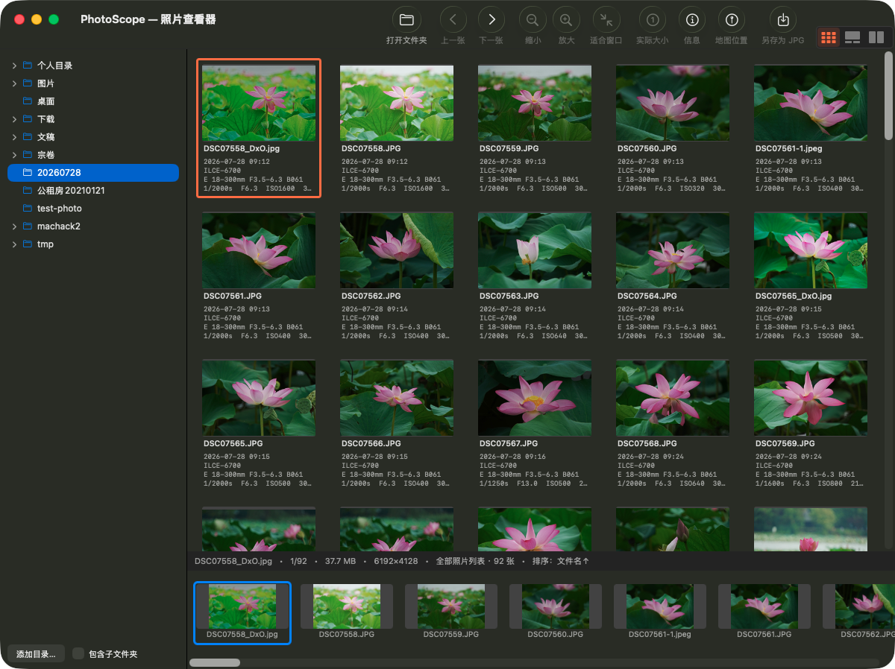
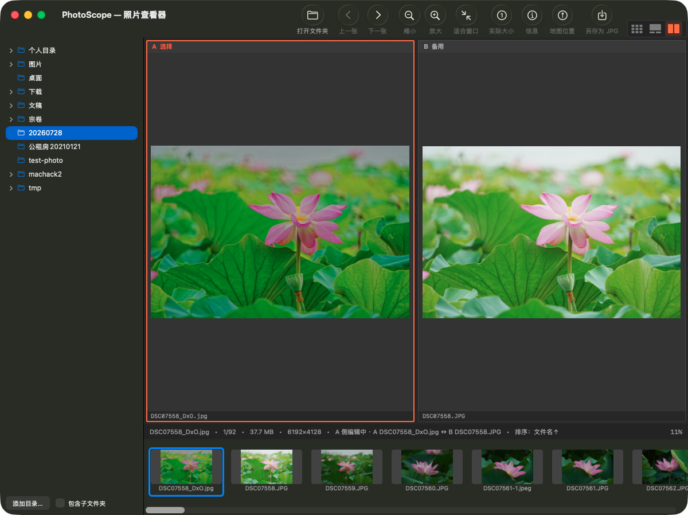

# PhotoScope 操作与功能说明

> 版本 1.6 ｜ macOS 13.0 及以上 ｜ universal（Apple Silicon `arm64` + Intel `x86_64`）
>
> PhotoScope 是一款本地运行的 macOS 照片/视频查看器：左侧选目录、右上（单张大图 / 全部照片网格 / 并排双图）、右下缩略图条、顶部工具栏。所有浏览与元数据读取都在本机完成，不上传照片。

主界面预览（单张视图）：




> 1.4 新增「全部照片列表（网格）」与「双张并排对比」，用标题栏右上角三段图标切换；界面预览见第七、八节。
> 1.5 新增「轨迹匹配写入 GPS」，1.6 起支持 **FIT 二进制轨迹**：用 GPX / TCX / FIT 按拍摄时间给选中照片或整个目录写入 GPS，支持小米伪 Z 时间修正（仅对文本轨迹生效）、滚动日志与自动 `.log` 落盘；详见第十三节。

轨迹处理页面预览：



1.6 起直接选择 FIT 轨迹（示例为 2400 点的大端 FIT，小米修正自动禁用）：



---

## 一、安装与启动

### 从 DMG 安装（推荐）

1. 双击 `PhotoScope-1.6.dmg`，挂载后出现 `PhotoScope.app`、`Applications` 快捷方式、`README.txt`（简版）和 `PhotoScope-操作与功能说明.md`（完整手册）。
2. 把 `PhotoScope.app` 拖到 `Applications`（应用程序）即可。
3. 双击启动。

### 首次打开被系统拦截

本程序为 **ad-hoc 签名、未做 Apple 公证**，Gatekeeper 可能提示「无法打开」或「已损坏」。两种处理方式：

- 在 Finder 中 **右键** `PhotoScope.app` →「打开」→ 再点一次「打开」；
- 或在终端执行：

```bash
xattr -dr com.apple.quarantine /Applications/PhotoScope.app
```

之后即可正常双击启动。首次访问「桌面 / 下载 / 文稿」等受保护目录时，macOS 可能弹出文件夹访问授权，请点「好」。

### 从源码构建

```bash
cd /Volumes/machack2/download/swift_program/PhotoScope
./build.sh                       # release + universal（默认）
./build.sh release native run    # 只编译本机架构，构建后直接启动
./make_dmg.sh                    # 重新生成 PhotoScope-1.6.dmg
```

---

## 二、界面布局

| 区域 | 位置 | 作用 |
| --- | --- | --- |
| 目录树 | 左侧约 250 pt，可拖动分隔线 | 选要看的文件夹；底部有「添加目录…」与「包含子文件夹」 |
| 主显示区 | 右上，三种模式 | ① 单张大图 / 视频 ② 全部照片列表（网格） ③ 并排双图对比 |
| 视图切换 | 标题栏右上角三段图标 | 网格（3×3 方格）｜单张（大方块）｜并排（两竖条）；当前段橙红高亮 |
| 状态栏 | 主显示区下方 | 文件名、`序号/总数`、文件大小、像素尺寸、视频标记、旋转角度、视图模式、操作提示；右侧显示缩放百分比 |
| 缩略图条 | 右下，横向滚动 | 当前目录全部媒体的缩略图，始终保留；可左右切换、多选、右键操作 |
| 工具栏 | 顶部 | 打开文件夹｜上一张/下一张｜缩小/放大/适合窗口/实际大小｜信息/地图位置/另存为 JPG/轨迹写入 GPS（纯图标 + 中文标签） |

窗口最小尺寸 940×620，标题栏与窗口位置会被系统记忆。

---

## 三、快速上手（7 步）

1. 点工具栏「**打开文件夹**」，或点左侧底部「添加目录…」，选中一个照片目录。
2. 目录树中单击某个文件夹，右下列出该目录全部照片与视频，并自动选中第一张。
3. 单击缩略图、点工具栏「上一张 / 下一张」、或按 `←` / `→` 切换照片。
4. 点「信息」看 EXIF；有 GPS 时「地图位置」会亮起，可查看拍摄点。
5. 点「另存为 JPG」，选择质量与保存位置，即可导出并保留原始 EXIF / GPS。
6. 点标题栏**右上角三段图标**切换「全部照片列表 / 单张 / 双张对比」，详见第六～八节。
7. 点工具栏「**轨迹写入 GPS**」或「工具 → 轨迹匹配写入 GPS…」，用轨迹文件补写拍摄位置，详见第十三节。

> 也可以不进程序：在访达里右键照片 →「打开方式」→ PhotoScope，程序会自动打开该照片所在目录并定位选中它，详见第四节。

---

## 四、目录树

- **内置快捷位置**：个人目录、图片、桌面、下载、文稿、宗卷（仅显示实际存在的目录）。
- **添加目录**：点「添加目录…」或工具栏「打开文件夹」，添加的目录会加入树中并记住（最多保留最近 20 个自定义目录）。
- **展开子目录**：点文件夹左侧三角按需加载，不会一开始就把整棵树展开。
- **包含子文件夹**：勾选后递归扫描所选目录下的所有子目录；取消勾选则只列当前层。切换时会立即重新扫描。
- **记住上次目录**：下次启动自动打开上次选中的目录。
- 扫描会跳过隐藏文件、包内容和常见的非媒体旁路文件（`.xmp` / `.aae` / `.dop` / `.gpx` 等）。

### 从访达直接打开照片（右键「打开方式」/ 双击）

程序的 `Info.plist` 声明了 `public.image` / `public.movie` 的 Viewer 角色，所以访达的「打开方式」里会列出 PhotoScope。本版本已实现系统的「打开文档」回调，**不会再出现**：

```
The document "xxx.JPG" could not be opened.
PhotoScope cannot open files in the "JPEG image" format.
```

- **操作**：访达中右键照片 →「打开方式」→ PhotoScope；或把照片拖到 Dock 上的 PhotoScope 图标；把 `.app` 设为默认程序后也可直接双击。
- **行为**：PhotoScope 是目录浏览器，收到单个文件时会打开该照片**所在的目录**，并在缩略图条中定位、选中这张照片，右上直接显示大图。
- 打开的是**目录** → 直接浏览该目录；打开的是 **RAW / HEIC / AVIF / 视频**等受支持格式 → 同样生效。
- PhotoScope **已在运行时**再打开别的文件，会切换到新文件所在目录并定位，不会新开一个窗口。
- 不支持的文件类型（如 `.txt`、`.mkv`）会被明确回绝；若文件被扫描规则跳过（隐藏文件、旁路文件等），状态栏会提示「未列出「xxx」」。
- 选中位置按文件 URL 匹配，因此即使当前排序是「拍摄日期降序」也能准确定位。
- **升级提示**：用新版 `.app` 覆盖旧版后，请先完全退出仍在运行的旧进程（`⌘Q`）再重新打开，否则访达的打开事件仍会发给旧实例。

---

## 五、缩略图条

- 单击缩略图 → 右上大图切换为该照片，状态栏与信息面板同步刷新。
- 横向滚动查看更多；缩略图异步生成并缓存，旋转后会自动失效重建。
- 视频缩略图右上角带「**视频**」角标；被旋转过的照片带角度角标（如 `90°`）。
- **多选**：按住 `⌘` 逐个点选、或按住 `Shift` 选连续范围。多选只用于批量右键操作，**不会改变当前大图**；单击单张才恢复导航。
- 右键落在已多选的照片内 → 对全部选中项批量操作；右键落在未选中的照片上 → 先把它设为当前照片再弹菜单。

旋转效果预览：



---

## 六、三种视图模式与右上角切换控件

标题栏**右上角**有一组三段图标，当前模式用橙红色标出：

| 段 | 图标 | 模式 | 作用 |
| --- | --- | --- | --- |
| 1 | 3×3 方格 | 全部照片列表 | 网格显示当前目录所有照片 + 简要 EXIF |
| 2 | 大方块 + 下方小方块 | 单张查看 | 程序原有视图：右上大图 / 视频 + 右下缩略图条 |
| 3 | 左右两竖条 | 双张对比 | 左右并排两张照片，各自可选图 |

- **切换**：点图标；或用「显示」菜单 → 全部照片列表 / 单张查看 / 双张对比（`⌥⌘1` / `⌥⌘2` / `⌥⌘3`）。
- **记住选择**：视图模式写入本机偏好，下次启动沿用；从访达打开照片时也保持当前模式并定位到该文件。
- 三种模式共用**同一份目录列表、排序结果与当前选中项**；右下缩略图条始终保留。状态栏会标注当前模式（如「全部照片列表 · 92 张」「A 侧编辑中 · A xxx ↔ B yyy」）。
- 切换视图只改显示，不写磁盘、不改原文件。

---

## 七、全部照片列表（网格视图）



- 右上区域改为可上下滚动的网格，一次列出当前目录（勾选「包含子文件夹」时含所有子目录）的**全部照片与视频**；列数随窗口宽度自动调整（约 930 pt 宽时 5 列）。
- 每格包含：缩略图、文件名、最多 4 行简要信息 —— 拍摄日期时间、机型、镜头、快门/光圈/ISO/焦距；无 EXIF 时用文件修改时间兜底，视频显示时长。
- **橙红色边框** = 当前选中照片；单击网格项会同步底部缩略图条、状态栏与信息面板。
- **双击**网格项 → 回到单张大图并选中该照片。
- `⌘` / `Shift` 多选、右键菜单与缩略图条完全一致（旋转、恢复方向、移到废纸篓、排序等）；右键落在未选中项上会先选中再弹菜单。
- 缩略图与简要 EXIF 都在后台异步读取并缓存，滚动大目录不会卡住界面。
- 网格模式没有大图，工具栏的放大 / 缩小 / 适合窗口 / 实际大小会置灰；切回单张或双图即恢复。

---

## 八、双张并排对比



- 左右两个独立面板：**A 选择** / **B 备用**，进入时默认显示相邻两张（末张时 B 回退到前一张）。
- 点击任一侧图片区域或顶部标签即可切换**活动侧**，活动侧带橙红色边框；状态栏显示 `A 侧编辑中 · A 文件名 ↔ B 文件名`。
- 活动侧的照片由底部缩略图条、`←` / `→`、工具栏「上一张 / 下一张」控制；另一侧保持不变。信息（EXIF）、地图位置、另存为 JPG 都作用于活动侧照片。
- **缩放联动**：工具栏放大/缩小、适合窗口、实际大小以及触控板捏合同时作用于两侧，右侧状态栏显示共同倍率，便于同倍率比较细节。
- 右键菜单里的非破坏性旋转同样会刷新到对比面板。
- 视频在对比模式下显示**封面帧**（不播放）；要播放请切回单张视图。

---

## 九、大图查看与缩放

| 操作 | 工具栏 / 菜单 | 说明 |
| --- | --- | --- |
| 放大 | 「放大」/ `⌘+` | 每次 ×1.25 |
| 缩小 | 「缩小」/ `⌘-` | 每次 ÷1.25 |
| 适合窗口 | 「适合窗口」/ `⌘0` | 按可视区等比缩放并居中，改变窗口大小时自动跟随 |
| 实际大小 | 「实际大小」/ `⌘1` | 100%（1 图像像素 = 1 屏幕点） |
| 手势缩放 | 触控板捏合 | 直接使用系统 `NSScrollView` 缩放，范围 2%–2000% |

- 大图默认「适合窗口」，并始终居中显示（不会贴在左下角）。
- 手动缩放后切换为手动模式，不再随窗口自动适配；再点「适合窗口」即可恢复。
- 右下角实时显示当前缩放百分比。
- 显示时会自动应用 EXIF 方向标记，以及你在右键菜单里追加的旋转。

---

## 十、信息（EXIF）面板

点工具栏「信息」或 `⌘I` 打开独立浮动窗口，特点：

- **分组显示**：文件、图像属性、容器信息、EXIF、TIFF、GPS 定位（原始）、ExifAux、IPTC、厂商扩展等；常见字段有中文名（如 ISO、光圈、曝光时间、焦距、镜头型号）。
- **跟随切换**：换照片时面板内容自动刷新，不必关闭重开。
- **一键复制**：点「复制全部信息」把整份纯文本送进剪贴板，便于贴到报告或表格里。
- **GPS**：读取标准 EXIF GPS 字典；部分 DJI 机型通过遥控器写入的坐标落在 XMP 里，程序会兜底解析；视频会尝试读 ISO 6709 位置。窗口底部显示「含 GPS 坐标」或「无 GPS 坐标」。
- 面板可缩放、可最小化，关闭后工具栏「信息」按钮的高亮会同步取消。

---

## 十一、地图位置（高德地图）

仅当当前照片/视频能读到 GPS 时，工具栏「**地图位置**」才可用（有 GPS 时按钮带强调色）。

### 首次配置 Key（必做一次）

1. 到 <https://lbs.amap.com> 控制台 → 应用管理 → 创建应用 → 添加 Key，服务平台选「**Web端 (JS API)**」。
2. 同一页面取得配套的「**安全密钥 jscode**」（2021-12-02 之后申请的 Key 必填；老 Key 可留空）。
3. 在 PhotoScope 中点「地图位置」打开窗口，在顶部两栏分别填入 **高德 Key** 与 **安全密钥**，点「应用」。
4. 如果给 Key 设过**域名白名单**，请放行 `photoscope.local`（WebView 页面 host），或干脆留空白名单。

Key 与安全密钥只保存在本机 `UserDefaults`（`PhotoScope.amapKey` / `PhotoScope.amapSecurityCode`），**源码和 DMG 中不含任何可用密钥**，也不会随程序分发给他人。

### 显示逻辑与坐标

- EXIF 里的 **WGS-84** 坐标会先转换为 **GCJ-02**（高德使用的坐标系）再打点，窗口底部同时显示两套坐标、海拔与来源。
- 标注为高德 Marker + 信息窗体，显示文件名与「拍摄位置 · GCJ-02」。
- **未配置 Key** 时不白屏：显示离线坐标卡片，含 WGS-84 / GCJ-02 数值与申请指引。
- **SDK 12 秒未加载完成**（Key 无效、网络不通、白名单未放行）时显示中文排障提示，而不是空白地图；高德弹出的 JS 报错会转到窗口底部提示，不阻塞页面。
- 常见失败原因：Key 类型不是「Web端 (JS API)」、漏填安全密钥、白名单未放行 `photoscope.local`、本机无法联网。

---

## 十二、另存为 JPG（格式转换 + EXIF 保留）

点工具栏「另存为 JPG」或 `⌘S`，也可在缩略图右键菜单里选「另存为 JPG…」（仅单选时可用）。

### 操作步骤

1. 保存面板默认文件名为「原文件名 `.jpg`」，可改名字与位置。
2. 面板下方有 **JPEG 质量**滑杆（**10%–100%**，默认 **90%**）和「默认」按钮（一键回到 90%）。
3. 点「存储」后开始导出；状态栏显示进度与结果，例如：
   `已导出 JPG（质量 90%，已保留 EXIF/GPS（4 组元数据））：/path/xxx.jpg`
4. 本次选择的质量会被记住，作为下次导出的默认值。也可通过「**文件 → JPG 导出质量…**」预先设置默认质量。

### 导出行为

- **按原始像素尺寸**全尺寸解码导出，不缩图；EXIF 方向与用户追加的旋转会**烘焙进像素**。
- **保留原始元数据**：EXIF / TIFF / GPS / IPTC / 厂商扩展等一并迁移到新 JPG。为避免「元数据说谎」，程序会：
  - 把 `Orientation` 重置为 1（像素已转正，防止看图软件再转一次）；
  - 按导出后的真实像素重写 `PixelWidth/Height`、`PixelXDimension/YDimension`（旋转 90° 后宽高互换）；
  - 剔除由 JPEG 编码器决定的旧值（`Compression`、`CompressedBitsPerPixel`、`FileSize`、`Depth` 等）；
  - 源文件只有 XMP(DJI) 坐标或视频 ISO 6709 坐标时，合成标准 EXIF GPS 字典写入。
- 厂商 MakerNote 等超大字段会裁剪（单字段 16 KB、整份元数据 48 KB 上限），避免 JPEG APP1 段溢出。
- 写入异常时**三级降级**：完整元数据 → 仅 EXIF/TIFF/GPS 核心三组 → 仅纯像素，保证导出不会因元数据整体失败；若最终只写成功图像，状态栏会明确提示「元数据写入失败，已仅保存图像」。
- 输出扩展名会自动规范为 `.jpg`；**不允许覆盖源文件**（同名会报错），请换一个文件名。
- **视频**：提取代表帧另存为 JPG，并尽量写入素材的拍摄时间与 GPS（视频本身没有 EXIF，能写多少取决于素材元数据）。

---

## 十三、轨迹匹配写入 GPS（1.5 新增，1.6 支持 FIT）

按照片的**拍摄时间**在轨迹里找最近的一个定位点，把经纬度（有海拔时连海拔一起）**原地写回照片文件**。参考实现是本机 Python 工具 `gps_write_photo_v2.py`，规则保持一致：**没有匹配上就不写入**，宁可留空也不写错位置。

> ⚠ **这是 PhotoScope 唯一会修改原始照片文件的功能**（旋转只是偏好覆盖、导出永远写新文件）。默认开启备份，提交前会二次确认。

### 打开页面

- 工具栏最右侧「**轨迹写入 GPS**」图标；
- 或「**工具 → 轨迹匹配写入 GPS…**」，快捷键 `⌥⌘G`。

页面是独立窗口，不占用主窗口；打开时会带上当前目录、当前列表和已多选的照片。

### 依赖：exiftool

原地写入 JPG / HEIC / 各家 RAW 的 EXIF GPS 需要外部命令 **exiftool**（https://exiftool.org/）。程序会依次在 `PATH`、常见安装位置（`/usr/local/bin`、`/opt/homebrew/bin` 等）和登录 shell 的 PATH 里查找：

- 找到 → 页面状态栏显示 `exiftool <版本> 已就绪`；
- 找不到 → 明确提示，**仍可解析轨迹、查看预览、试运行匹配，但提交会被阻止**。
- exiftool 只是可选运行时工具，**不链接、不打包进 `.app`**，不违反零第三方编译依赖；本机 `/usr/local/bin/exiftool` 已可用。

### 页面五项内容

| 区域 | 操作 |
| --- | --- |
| ① 轨迹文件 | 点「选择轨迹文件…」选 GPX / TCX / FIT（格式自动识别，FIT 用文件头 `.FIT` 判定）。选完立即后台解析，路径显示在按钮右侧 |
| ② 轨迹时间预览 | 显示格式、点数、时间范围（UTC 与北京）、**前 3 条点**的原始时间 / 解释后 UTC / 北京时间 / 坐标海拔（FIT 显示由二进制时间戳还原的 UTC 文本） |
| ③ 小米修正 | 勾选「小米轨迹时间修正」；切换后预览立即重算，方便判断是否该勾。**选中 FIT 时自动禁用**（二进制时间戳无关伪 Z） |
| ④ 处理范围 | 单选「仅处理选中的 N 张照片」或「处理当前目录的全部 N 张照片」 |
| ⑤ 匹配选项 | 容差、照片时区、覆盖已有 GPS、备份、含视频、仅预览匹配；底部「提交处理 / 取消 / 关闭」与滚动日志 |

**「仅处理选中的照片」**：取缩略图条或网格视图里的多选集合（⌘ / Shift 多选）；未多选时退化为当前这一张。**「全部照片」**：当前目录列表里的全部照片（「包含子文件夹」递归开关同样生效），默认不含视频，可勾选「同时处理视频文件」。

### 时间口径（最容易出错的地方）

| 轨迹里的时间文本 | 程序解释 |
| --- | --- |
| `2026-09-26T01:34:29Z`（真 UTC） | 直接当 UTC |
| `2026-09-26T09:34:29+08:00` | 按偏移真换算 → UTC `01:34:29` |
| `2026-09-26T09:34:29Z`（**小米伪 Z**：其实是北京时间） | 不修正时当 UTC `09:34:29`（会差 8 小时）；**勾选小米修正** → UTC `01:34:29` |
| 无时区后缀 | 默认当 UTC；小米修正时同样减 8 小时 |

小米修正**只作用于 GPX / TCX 里 `Z` / 无后缀**的时间，带数字偏移的时间不受影响。判断方法：预览区看「北京时间」一行，若照片拍摄时间约为 `09:xx` 而轨迹显示 `17:xx`，就该勾选修正。

**FIT 的时间口径不同**：FIT 里没有时间文本，只有 `uint32` 秒数（起算点 1989-12-31 00:00:00 UTC，按 FIT 规范即 UTC）。程序会把它还原成 UTC 绝对时间，并生成等价的 `2026-10-04T02:15:09Z` 文本用于预览；小米修正对 FIT 一律不生效，也不需要生效。若 FIT 轨迹的北京时间与照片拍摄时间仍差约 8 小时，说明导出该 FIT 的设备时钟本身被设成了本地时间，需先用厂商工具转换或改用已修正的 GPX / TCX。

照片侧：读 `SubSecDateTimeOriginal` → `DateTimeOriginal` → `CreateDate`，按「照片时区 UTC+8」把本地墙钟换算为 UTC；视频用 `-api QuickTimeUTC` 读出的带偏移时间直接换算。

### 匹配与写入规则

1. 在全部轨迹点里找与照片 UTC 时间**绝对差最小**的一个点；
2. 差值超过「匹配容差」（默认 30 秒）→ 不写入，日志写明相差多少秒；
3. 照片已有 GPS 且未勾「覆盖已有 GPS」→ 跳过，日志同时列出原 GPS 与匹配点；
4. 通过检查 → 写入 `GPSLatitude / Longitude`（含 N/S/E/W 参考）、`GPSAltitude`（含 Above/Below Sea Level 参考）；视频写 `Keys:GPSCoordinates`；
5. 默认在**每个文件所在目录**下建 `exif_backup/` 备份原文件，同名备份自动加序号，绝不覆盖；
6. 每个文件一行结果（`✓ 已写入` / `✗ 未写入` / `⊘ 跳过` / `✗ 失败`），底部实时滚动；
7. 结束在**当前照片目录**生成 `GPS写入日志_yyyyMMdd_HHmmss.log`（文件名与日志行时间均为北京时间），内容就是窗口里的完整日志加时间戳。

可先勾「**仅预览匹配结果（不改动任何文件）**」试跑一次，统计显示「可匹配 N / 不匹配 N【仅预览，未写入】」。

### 支持与不支持

- **GPX**：`trkpt` / `rtept` / `wpt`；**TCX**：`Trackpoint`（兼容小米把 `AltitudeMeters` 嵌在 `Position` 内的写法）。
- **FIT**：Garmin FIT 二进制轨迹，程序内置纯 Swift 最小解码器，**不需要再转 GPX / TCX，也不依赖任何第三方库**。读取 `record` 消息（global #20）的时间戳 / 经纬 / 海拔，支持 12 与 14 字节文件头、大端与小端、压缩时间戳头、开发者字段和无效值；坐标按 semicircles 换算、海拔按 scale/offset 换算。
- **FIT 范围**：只解析定位点，不解析圈速、心率、功率等其它消息；不校验文件 CRC。部分设备会把时间写成非 UTC 的本地墙钟，此时需先用厂商工具修正（预览区可核对）。
- **照片**：JPG / JPEG / HEIC / HEIF / TIFF / PNG 及各家 RAW 均可由 exiftool 写入；**视频**：需勾选「同时处理视频文件」。
- 程序会跳过没有拍摄时间的文件；写入后主窗口自动刷新当前照片的 EXIF，「地图位置」按钮随之可用。

### 建议流程

1. 选轨迹（GPX / TCX / FIT 均可）→ 看预览的前 3 条时间与范围 → GPX / TCX 再决定是否勾「小米轨迹时间修正」；
2. 勾「仅预览匹配结果」+「全部照片」→ 提交，看能匹配上多少张；
3. 取消「仅预览」，确认备份已勾 → 提交 → 核对滚动日志与目录下生成的 `.log`；
4. 若要重跑，勾「覆盖已有 GPS」，或先从 `exif_backup/` 还原。

---

## 十四、视频播放

- 选中视频时右上显示**封面帧 + 高对比「▶ 播放视频」按钮 + 文件名**。
- 点按钮后交给系统 `AVPlayerView` 播放：内建播放/暂停、进度拖动、音量、全屏切换。
- 切换照片或目录时自动停止并释放播放器。
- 视频的**播放方向无法被右键旋转覆盖**（旋转项对视频禁用），但封面帧与导出 JPG 仍可应用旋转。

---

## 十五、缩略图右键菜单

在缩略图上右键，菜单如下（带 SF Symbols 图标，当前排序项带勾选）：

```
顺时针旋转 90°
逆时针旋转 90°
恢复原始方向                 （仅当所选照片有旋转记录时可用）
────────
在 Finder 中显示
复制文件路径
移到废纸篓（N 项）           （多选时显示数量）
另存为 JPG…                  （仅单选可用）
────────
排序方式（当前：文件名↑）
    ├─ 按文件名               ✓
    ├─ 按拍摄日期及时间
    ├─ 按型号名
    ├─ 按镜头名
    ├─ ────────
    ├─ 升序排序               ✓
    ├─ 降序排序
    ├─ ────────
    └─ 恢复默认排序
```

| 功能 | 说明 |
| --- | --- |
| 顺 / 逆时针旋转 90° | **非破坏性**：只在偏好里记录该文件的旋转覆盖，不改动原文件；大图、缩略图、导出 JPG 统一叠加；可批量 |
| 恢复原始方向 | 清除所选照片的旋转覆盖 |
| 在 Finder 中显示 | 在 Finder 中选中对应文件，可批量 |
| 复制文件路径 | 多选时按行拼接复制到剪贴板 |
| 移到废纸篓 | 弹确认框 → 调用系统废纸篓（**可恢复，不是永久删除**），同时清除这些文件的旋转记录；部分失败会单独提示 |
| 另存为 JPG… | 与工具栏导出完全相同 |
| 排序方式 | 4 种字段 × 升/降序，设置会记住并在右键菜单、主菜单「显示 → 排序方式」之间同步；排序后按文件路径找回当前照片，大图不会跳到别的照片 |

排序取数说明：

- **文件名**：系统本地化排序（数字按自然序）；
- **拍摄日期及时间**：EXIF `DateTimeOriginal`，视频取素材创建时间；
- **型号名 / 镜头名**：EXIF `Model` / `LensModel`；
- 缺该字段的照片**恒定排在末尾**（升序、降序都置底），不会插到中间；
- 读取在后台并发执行并缓存，切换目录时按记住的排序偏好自动排好。

---

## 十六、主菜单与快捷键

| 菜单 | 项目 | 快捷键 |
| --- | --- | --- |
| 文件 | 打开文件夹… | `⌘O` |
| 文件 | 另存为 JPG… | `⌘S` |
| 文件 | JPG 导出质量… | — |
| 文件 | 移到废纸篓… | — |
| 显示 | 全部照片列表 / 单张查看 / 双张对比 | `⌥⌘1` / `⌥⌘2` / `⌥⌘3` |
| 显示 | 放大 / 缩小 | `⌘+` / `⌘-` |
| 显示 | 适合窗口 / 实际大小 | `⌘0` / `⌘1` |
| 显示 | 上一张 / 下一张 | `←` / `→`（主窗口为焦点时；双图模式只切换活动侧） |
| 显示 | 顺时针 / 逆时针旋转 90° | `⌘]` / `⌘[` |
| 显示 | 恢复原始方向 | — |
| 显示 | 排序方式（子菜单，带勾选） | — |
| 显示 | 照片信息 (EXIF) | `⌘I` |
| 显示 | 在地图上显示 | `⌘M`（若被系统「最小化」占用，请点工具栏「地图位置」） |
| 编辑 | 复制 / 全选 | `⌘C` / `⌘A`（信息面板文本框内） |
| 工具 | 轨迹匹配写入 GPS… | `⌥⌘G` |

右键菜单与主菜单共用同一套处理逻辑，结果完全一致。

---

## 十七、支持的格式

| 类别 | 扩展名 |
| --- | --- |
| 常规照片 | JPG / JPEG / JPE / JFIF、PNG、TIF / TIFF、GIF、BMP、WebP、PSD、ICO |
| HEIF / AVIF | HEIC、HEIF、HIF、AVIF、AVIFS |
| 相机 RAW | ARW / SRF / SR2（Sony）、NEF / NRW（Nikon）、CR2 / CR3 / CRW（Canon）、DNG、RAF（Fujifilm）、RW2（Panasonic）、ORF（Olympus）、PEF（Pentax）、3FR / FFF / IIQ（Hasselblad / Phase One）等 40+ 种 |
| 视频 | MOV、MP4、M4V、MTS / M2TS / TS、AVI、MPG / MPEG、3GP / 3G2、VOB、HEVC、H264、QT |
| 轨迹（第十三节） | GPX、TCX、FIT（内置解码，无需转换） |

- 判定顺序为「扩展名白名单 → UTType 兜底」，未来系统新增格式也可能被识别；**实际能否解码取决于本机 macOS 的 ImageIO / AVFoundation**（例如个别新机身 RAW 需系统更新后才支持，解码失败会给出明确提示）。
- 明确排除 `.mkv` / `.webm` / `.flv` / `.wmv` / `.rmvb` 等 macOS 不能稳定解码的封装，以及 `.xmp` / `.aae` / `.dop` / `.gpx` / `.lrv` 等旁路文件。

---

## 十八、偏好、文件安全与已知限制

**本机保存的偏好（UserDefaults）**：上次打开的目录、自定义目录列表、排序字段与方向、**视图模式（网格 / 单张 / 双图）**、JPG 导出质量、每张照片的旋转覆盖、高德 Key 与安全密钥。

**对磁盘的写入只有三类**：

1. 「另存为 JPG」写出一个新 `.jpg`（不会覆盖源文件）；
2. 「移到废纸篓」把文件移入系统废纸篓（可恢复）；
3. **「轨迹匹配写入 GPS」原地改写所选照片的 EXIF GPS，并在当前目录生成 `.log` 日志**（第十三节）。

第 3 项是唯一改动原始照片的功能：提交前二次确认，默认备份到各文件所在目录的 `exif_backup/`，默认跳过已有 GPS，超出容差绝不写入。若关闭备份，写入不可自动回滚，可从备份目录或手动副本恢复。浏览、查看 EXIF、看地图、旋转、排序都**不会修改原照片**。

**已知限制**

- 旋转覆盖是本机偏好，用其他看图软件打开同一文件不会看到旋转；需要给别人看时请「另存为 JPG」把旋转烘焙进像素。
- 视频播放方向无法覆盖；视频能写出的 EXIF 取决于素材是否含创建时间 / GPS。双张对比模式显示视频封面帧，播放需切回单张视图。
- 并排对比的两侧使用同一缩放倍率；两张原始像素尺寸差异很大时，其中一张会显得较小。
- 少数 EXIF 字段（如部分机型的 `ImageStabilization`、个别 RAW 的 `{Exif}.ColorSpace`）由 ImageIO 的 JPEG 编码器忽略，属于系统行为，不算导出失败。
- 超大的厂商 MakerNote 会被裁剪以适配 JPEG APP1 段限制。
- 高德地图需要**你自己申请的有效 Key**，未配置时只显示坐标卡片；真实 Key 下的瓦片加载依赖网络与 Key 的域名白名单设置。
- 轨迹写入依赖本机 **exiftool**；未安装时只能解析/预览/试运行，不能提交。FIT 由程序内置解码器解析，不依赖 exiftool 或 fitparse，但**写入 GPS 仍需 exiftool**。轨迹与照片时间口径不一致（尤其小米伪 Z）会导致整批不匹配，先用「仅预览匹配结果」核对。
- 应用为 ad-hoc 签名、未公证，首次打开需按上文处理 Gatekeeper。

---

## 十九、命令行自检与诊断

```bash
# 不启动 UI，逐项验证格式识别、坐标转换、菜单、旋转、排序、视图模式、
# 轨迹解析（GPX / TCX / FIT）/ 小米时间修正 / GPS 写入参数、EXIF/GPS 保留等
"/Applications/PhotoScope.app/Contents/MacOS/PhotoScope" --selftest --dir /path/to/photos

# 启动时直接打开指定目录，并直接进入网格 / 双图视图（不改动记住的视图偏好）
"/Applications/PhotoScope.app/Contents/MacOS/PhotoScope" --dir /path/to/photos --view-mode grid
"/Applications/PhotoScope.app/Contents/MacOS/PhotoScope" --dir /path/to/photos --view-mode compare

# 无交互打开轨迹处理页面：加载轨迹 + 小米修正 + 全部照片 + 仅预览（不写文件）
# --gps-track 可直接传 .fit；FIT 由内置解码器解析，且会自动忽略 --gps-xiaomi
"/Applications/PhotoScope.app/Contents/MacOS/PhotoScope" --dir /path/to/photos \
    --show-gps-writer --gps-track /path/to/track.gpx --gps-xiaomi \
    --gps-scope all --gps-run --gps-dry-run \
    --screenshot /tmp/gps.png --delay 10 --quit-after-screenshot
```

自检输出逐行 `PASS` / `FAIL`，全部通过时退出码为 `0`，有失败项为 `1`。1.6 基线为 **161 PASS / 0 FAIL**（其中 16 项为 FIT 解码与真实样本回归）。

轨迹相关参数：`--show-gps-writer`（打开页面）、`--gps-track <路径>`（预选轨迹）、`--gps-xiaomi`（勾小米修正）、`--gps-scope <selected|all>`（范围）、`--gps-run`（跳过确认自动提交）、`--gps-dry-run`（只匹配不写入）。

其余参数主要供开发/自动化验证界面使用：`--dir <目录>`、`--view-mode <grid|single|compare>`、`--dump-view-mode`（打印当前模式、网格列数、A/B 照片）、`--compare-side <left|right>`（模拟点击对比面板）、`--open-file <文件路径>`（模拟访达「打开方式」）、`--select <文件名>`、`--show-info`、`--show-map`、`--map-debug`、`--show-save`、`--dump-quality <png>`、`--show-quality-preview`、`--rotate <n>`、`--sort-by <key>`、`--dump-context-menu`、`--dump-layout`、`--screenshot <png>`（可配 `--delay`、`--quit-after-screenshot`）、`--capture-windows <前缀>`（可配 `--capture-delay`）。

---

## 二十、项目结构

```
PhotoScope/
├── Package.swift                 # SwiftPM，macOS 13+，纯 AppKit，无第三方依赖
├── build.sh                      # 编译 + 组装 .app（ad-hoc 签名）
├── make_dmg.sh                   # 生成 UDZO 压缩 DMG 并校验挂载
├── PhotoScope-1.6.dmg            # 分发安装包（推荐）
├── PhotoScope.app                # 可直接运行的应用程序
├── PhotoScope-操作与功能说明.md  # 本文档（用户手册，随 DMG 分发）
├── PhotoScope-设计文档.md        # 续开发交接文档（不随 DMG 分发）
├── Support/
│   ├── Info.plist                # 版本 1.6、图标、文档类型、权限说明
│   ├── AppIcon.icns / .png       # 应用图标
│   ├── generate_icon.swift       # 图标矢量绘制脚本
│   ├── Preview.png               # 单张视图预览
│   ├── Preview-Rotation.png      # 旋转效果预览
│   ├── Preview-Grid.png          # 全部照片列表（网格）预览
│   ├── Preview-Compare.png       # 双张并排对比预览
│   ├── Preview-GPS.png           # 轨迹匹配写入 GPS 页面预览
│   └── Preview-GPS-FIT.png       # 1.6 FIT 轨迹加载预览
└── Sources/PhotoScope/
    ├── AppDelegate.swift / main.swift / MainWindowController.swift
    ├── Models/        # MediaItem、DirectoryNode、MediaSortOptions、ViewMode
    ├── Services/      # 扫描、解码、缩略图缓存、元数据、EXIF 保留、坐标转换、
    │                  # 高德页面、JPG 导出、旋转存储、排序索引、网格简要 EXIF、
    │                  # 访达打开路由、轨迹解析、exiftool 调用、GPS 批量写入
    ├── Views/         # 目录树、大图、缩略图条、右键菜单、信息面板、地图窗口、
    │                  # 视频播放、质量控件、视图切换控件、网格视图、并排对比视图、
    │                  # 轨迹处理页面
    └── SelfTest.swift # 命令行自检
```
